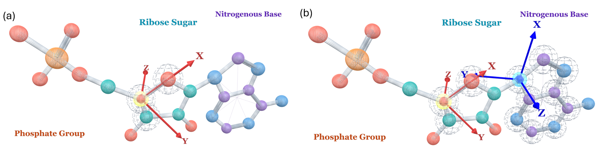
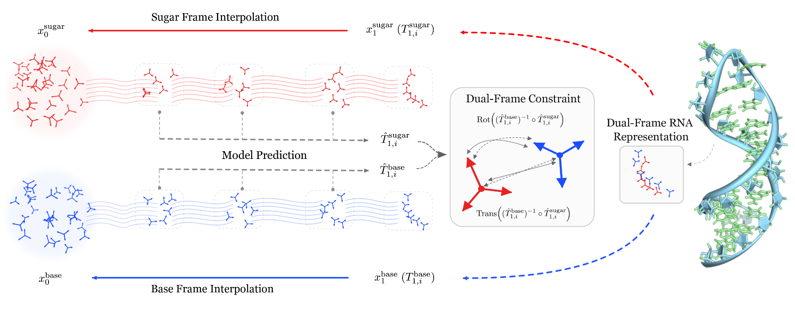
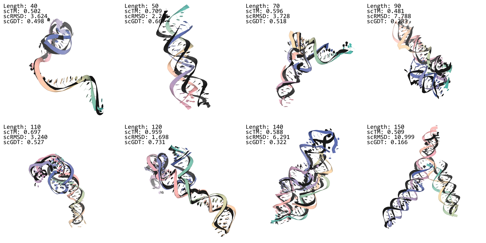

# DuetRNA: RNA sequence–structure co-generation with dual coordinate frames

*— Why do we give RNA two coordinate frames?*

**Junzhe Li**  
The Chinese University of Hong Kong · Wave Intelligence Lab

## What is RNA sequence–structure co-design, and what problem does it address?

Designing an RNA means answering two questions at once: which nucleotides make up its sequence, and what three-dimensional structure they can form. Many RNA functions depend on a particular spatial organization, so compatibility between sequence and structure is an essential part of the design problem.

Common approaches start from different inputs. Sequence-conditioned structure prediction takes an existing sequence and predicts the three-dimensional structure it may adopt. Structure-first design generates or selects a backbone, then uses inverse folding to find a sequence that fits it; in a two-stage pipeline, however, a backbone generated in isolation may not always admit a compatible sequence, and mismatches from the first stage can carry over into sequence design. When designing a new RNA, we often have neither an existing sequence nor a uniquely specified target backbone, and need to explore their combinations together.

**RNA sequence–structure co-design aims to directly generate mutually compatible sequences and structures.** DuetRNA studies unconditional generation within this task: it jointly generates an RNA sequence and a three-dimensional structure without a prescribed sequence or backbone. To make the two compatible, the model needs to account for base pairing and stacking as well as local conformations of the sugar–phosphate backbone. We start from nucleotide chemistry to find a representation that accommodates both geometric requirements. [[1]](https://www.biorxiv.org/content/10.64898/2026.08.18.745543v1)

## Why give a nucleotide two coordinate frames?

In frame-based RNA generation, a common approach follows the single-residue N–Cα–C frame paradigm from protein generation: assign one local coordinate frame to each nucleotide and use torsion angles to complete its atomic structure. RNA-FrameFlow uses this representation to generate backbones, while RiboFlow combines sugar frames, torsions, and nucleotide-type probabilities for co-design. [[2]](https://arxiv.org/abs/2406.13839) [[4]](https://arxiv.org/abs/2503.17007) Unlike proteins—where the peptide plane is nearly rigid and side chains branch off Cα—an RNA sugar–phosphate backbone spans multiple rotatable torsions and sugar-pucker states, whereas the nearly planar, rigid nucleobases directly mediate pairing and stacking. A frame provides a position and orientation for reconstructing atoms, but given this structural difference, where we anchor it also affects how geometric relationships between nucleotides are presented to the model.

We initially wanted to extend our group's work on **inertial frames**: defining local coordinate systems through the principal axes of the atomic inertia tensor, then exploring this idea for RNA. [[7]](https://openreview.net/forum?id=jckKNzYYA6)

But RNA already has a clear chain direction, defined atom identities, and stable local chemistry. In our early exploration, we used the **rigidity and stability of the nucleobase** to construct inertial frames. We also found that a base frame defined by the **base plane and an in-plane chemical direction** could describe interactions between nucleotides more directly. Analyses of local structures and multiple conformations further supported this choice: anchoring the frame where pairing, stacking, and relative orientation occur.

Describing relationships between bases, however, does not resolve every geometric requirement of a nucleotide. Bases participate in pairing and stacking, while the sugar–phosphate backbone provides connectivity and local conformation. The former calls for a direct description of relative orientations across nucleotides; the latter requires local geometry suitable for atomic reconstruction. Using a single frame often involves a trade-off between these two demands: from a sugar-anchored frame, base orientation sits across the rotatable glycosidic bond and is expressed indirectly through local degrees of freedom; conversely, from a base-anchored frame, the sugar and phosphate groups lie on the other side of that linkage, lengthening the path for local backbone reconstruction. We therefore considered adding a base frame to the sugar frame, assigning them complementary geometric roles while letting them jointly describe one nucleotide.

DuetRNA ultimately uses Base-Plane together with Sugar-GS. Base-Plane defines orientation through the base plane and an in-plane chemical direction, with its origin at the glycosidic connection atom N9 or N1. Sugar-GS constructs an orthonormal basis from the sugar's O4′–C4′–C3′ atoms, with its origin at C4′. Each nucleotide is thus described by two SE(3) frames, one on the base and one on the sugar, with torsion angles completing the remaining sugar–phosphate backbone atoms. [[1]](https://www.biorxiv.org/content/10.64898/2026.08.18.745543v1)

Figure 1: The left panel describes local structure with a sugar frame; the right adds a base frame. DuetRNA combines Base-Plane and Sugar-GS. Source: DuetRNA, Figure 1. [[1]](https://www.biorxiv.org/content/10.64898/2026.08.18.745543v1)

## Testing whether the two frames are complementary

To test this division of geometric roles, we compared seven nucleotide frame constructions across 11,497 static RNA chains and 31,432 multi-state relation groups. The analysis addressed two questions: whether a given interaction retains a stable description across conformations, and whether the representation supports atomic reconstruction. [[1]](https://www.biorxiv.org/content/10.64898/2026.08.18.745543v1)

For canonical cWW base pairs, multi-state rotational drift is 13.35° with Sugar-GS and **7.78°** with Base-Plane. Relative translational drift also falls from 1.70 Å to **0.61 Å**. Anchoring the frame to the base gives this type of pairing a more stable description. [[1]](https://www.biorxiv.org/content/10.64898/2026.08.18.745543v1)

Local chemistry offers an explanation. The geometry of cWW pairing is defined by the two Watson–Crick edges and the cis orientation of the glycosidic bonds, while each aromatic base ring is approximately rigid and planar. [[6]](https://rnajournal.cshlp.org/content/7/4/499) Describing the same pair from sugar frames also introduces changes in each base's orientation relative to its sugar, including glycosidic torsion χ and sugar puckering, such as C3′-endo and C2′-endo. [[5]](https://www.nature.com/articles/s41467-025-56261-7) Anchoring frames to the bases brings the base-plane normal and in-plane orientation directly into the SE(3) representation, reducing the contribution of these internal degrees of freedom to the description of pairing. This provides a geometric explanation for the observed stability difference.

Reconstruction analysis tested the other requirement. Keeping the Sugar-GS backbone reconstruction path while using the base frame to place base atoms reduces reconstruction RMSD for the base atoms from 6.21 Å to **1.58 Å**, with reconstruction errors for the sugar ring and phosphate groups unchanged. [[1]](https://www.biorxiv.org/content/10.64898/2026.08.18.745543v1) Together, these analyses support a complementary representation: the base frame directly describes pairing relationships, while the sugar frame retains the geometry needed for backbone reconstruction.

We therefore chose to model RNA with dual frames. The next question is how to make the model generate both frames at once while keeping them compatible.

## Joint generation with relative-pose supervision

DuetRNA represents each nucleotide as a pair of rigid-body states: a base frame and a sugar frame. For an RNA with N nucleotides, continuous geometry is generated through joint flow matching on (SE(3) × SE(3))N. Sequence and local torsion angles are predicted from the coupled features. [[1]](https://www.biorxiv.org/content/10.64898/2026.08.18.745543v1)

### Learning dual-frame flow matching from interpolation paths

During training, we interpolate between noise and the real structure, then train the model to predict clean endpoints from intermediate states. Let f ∈ {base, sugar} distinguish the two frames, x denote position, and R denote rotation. Time t = 0 corresponds to noise, and t = 1 to the real structure. Positions interpolate linearly in three-dimensional space, while rotations follow geodesics on SO(3):

$$
x_t^f=(1-t)x_0^f+t x_1^f
$$

$$
R_t^f=\operatorname{Exp}_{R_0^f}\!\left(t\operatorname{Log}_{R_0^f}(R_1^f)\right)
$$

The model predicts endpoint positions and orientations from the current state; hats denote these predictions. The differences between the predicted endpoints and the current state define the velocities of the two flows:

$$
u_t^{\mathrm{trans},f}=\frac{\hat x_1^f-x_t^f}{1-t}
$$

$$
u_t^{\mathrm{rot},f}=\frac{\operatorname{Log}_{R_t^f}(\hat R_1^f)}{1-t}
$$

Generation starts from noise and progressively updates both frames according to these velocities. During training, endpoint positions and rotations are supervised separately for the base and sugar frames. For each frame type f, the frame flow matching objective is:

$$
\mathcal L_{\mathrm{frame}}^f=\frac1N\sum_{i=1}^N\frac{\|\hat x_{1,i}^f-x_{1,i}^f\|_2^2}{(1-\bar t)^2}+\frac1N\sum_{i=1}^N\frac{\|\operatorname{Log}_{R_{t,i}^f}(\hat R_{1,i}^f)-\operatorname{Log}_{R_{t,i}^f}(R_{1,i}^f)\|_2^2}{(1-\bar t)^2}
$$

Here, N is the number of nucleotides, and t̄ = min(0.9, t) limits the time weighting in the loss. [[1]](https://www.biorxiv.org/content/10.64898/2026.08.18.745543v1) Within the network, bases and sugars have separate feature streams, coupled through shared pair representations and cross-object information exchange. The model therefore processes a joint geometric state throughout training.

### Connecting the predicted endpoints through relative pose

The two flows predict their own positions and orientations, but they also need to specify how those predictions fit together within one nucleotide. We therefore supervise relative pose: where the sugar is located and how it is oriented with respect to the base. During training, the loss compares the base-to-sugar transform at the predicted endpoints with its counterpart in the real structure, supervising both relative translation and rotation:

$$
\begin{aligned}
\mathcal L_{\mathrm{constraint}}
&=\frac1N\sum_{i=1}^{N}\Bigl\|
  (\hat R_{1,i}^{\mathrm{base}})^\top
  (\hat x_{1,i}^{\mathrm{sugar}}-\hat x_{1,i}^{\mathrm{base}})
  -(R_{1,i}^{\mathrm{base}})^\top
  (x_{1,i}^{\mathrm{sugar}}-x_{1,i}^{\mathrm{base}})
\Bigr\|_2^2\\[1em]
&\quad+\frac1N\sum_{i=1}^{N}\Bigl\|
\log\!\Bigl(
  \bigl[(\hat R_{1,i}^{\mathrm{base}})^\top\hat R_{1,i}^{\mathrm{sugar}}\bigr]^\top
  \bigl[(R_{1,i}^{\mathrm{base}})^\top R_{1,i}^{\mathrm{sugar}}\bigr]
\Bigr)\Bigr\|_2^2
\end{aligned}
$$

The first term compares sugar positions in base-frame coordinates; the second compares sugar orientations in the same coordinates. Hats mark model-predicted endpoints, while unhatted quantities come from the real structure. Subscript 1 denotes the endpoint, and i the nucleotide. The two frame flow matching objectives and this relative-pose constraint form the joint geometric training objective:

$$
\mathcal L_{\mathrm{Dual-Frame}}=\mathcal L_{\mathrm{frame}}^{\mathrm{base}}+\mathcal L_{\mathrm{frame}}^{\mathrm{sugar}}+\mathcal L_{\mathrm{constraint}}
$$

Translating or rotating the whole molecule does not change this within-nucleotide relative transform. It directly describes an internal relationship, independently of the molecule's arbitrary placement in space. This supervision lets the base and sugar frames retain their own generative degrees of freedom while learning how to form an internally coordinated nucleotide. [[1]](https://www.biorxiv.org/content/10.64898/2026.08.18.745543v1)

Figure 2: The two flows jointly predict base and sugar endpoints, coupled through a within-nucleotide relative-pose objective. Source: DuetRNA, Figure 2. [[1]](https://www.biorxiv.org/content/10.64898/2026.08.18.745543v1)

### From geometric states to a sequence and atomic structure

The coupled geometric features also feed two prediction heads: one predicts whether each position should be A, U, G, or C, and the other predicts local torsion angles. The base frame then places the corresponding base template, while the sugar frame and torsions reconstruct the sugar–phosphate backbone. The final output is an RNA sequence together with its three-dimensional heavy-atom coordinates. [[1]](https://www.biorxiv.org/content/10.64898/2026.08.18.745543v1)

## Do the generated sequences and structures agree?

We evaluate the representation and training objectives through the computational self-consistency of generated sequences and structures, using two protocols. **IF** first uses an external inverse-folding model to design sequences for a generated structure, then predicts their folds to assess backbone designability. **GS** directly folds the sequence generated by DuetRNA to test whether it matches the generated structure. Both count scTM ≥ 0.45 as computational self-consistency, but they answer different questions. [[1]](https://www.biorxiv.org/content/10.64898/2026.08.18.745543v1)

### Backbone designability and sequence–structure compatibility

The main results from Table 2 of the paper are summarized below: [[1]](https://www.biorxiv.org/content/10.64898/2026.08.18.745543v1)

| Evaluation | Method | Self-consistency |
| --- | --- | --- |
| IF / RhoFold | RNA-FrameFlow | 41.00% |
| IF / RhoFold | DuetRNA | **48.67%** |
| GS / Boltz-1 | RiboGen | 34.17% |
| GS / Boltz-1 | DuetRNA | **38.50%** |

In the IF / RhoFold evaluation, each method generates 600 samples spanning 40–150 nt. DuetRNA achieves 48.67% self-consistency, **7.67 percentage points** higher than RNA-FrameFlow. Both methods use the same external models for sequence design and refolding, so this improvement reflects better backbone designability: more generated backbones can be matched with compatible sequences. [[1]](https://www.biorxiv.org/content/10.64898/2026.08.18.745543v1)

Under GS / Boltz-1, DuetRNA achieves 38.50% self-consistency, **4.33 percentage points** higher than RiboGen [[3]](https://arxiv.org/abs/2503.02058). This result addresses an additional requirement of co-design: the model must produce both a designable structure and a compatible sequence. Together with the IF results, this shows gains at two levels: generated backbones are more amenable to sequence design, and the model itself produces more compatible sequence–structure pairs. [[1]](https://www.biorxiv.org/content/10.64898/2026.08.18.745543v1)

We then ask: is adding a coordinate frame alone enough to achieve these improvements?

### What relative-pose supervision contributes

The ablation study tests more directly why the dual-frame representation is useful. We compare three settings: a sugar frame alone, two frames without relative-pose supervision, and full DuetRNA. Table 3(a) reports the corresponding IF / RhoFold results: [[1]](https://www.biorxiv.org/content/10.64898/2026.08.18.745543v1)

| Model | Self-consistency |
| --- | --- |
| Sugar frame only | 34.67% |
| Two frames without relative-pose supervision | 30.00% |
| Full DuetRNA | **48.67%** |

Adding a base frame while removing relative-pose supervision brings no improvement. (This ablation removes the relative-pose loss; the network still exchanges information between the base and sugar representations.) **Adding a geometric variable does not guarantee better performance;** explicitly learning the relationship between base and sugar is key to making the two frames useful.

One possible mechanism is that dual frames enlarge the pose space of each nucleotide, so without relative-pose supervision the two predicted endpoints are more prone to drift out of agreement during sampling. Base atoms are placed through the base frame, while the backbone is reconstructed through the sugar frame; if the two do not meet cleanly, local geometry around the glycosidic linkage (C1′–N9/N1) may be stretched or distorted.

Figure 3: Colored structures are generated; dark gray structures are RhoFold predictions for the corresponding designed sequences. Selected samples at different lengths illustrate computational self-consistency through structural overlays. Source: DuetRNA, Figure 3. [[1]](https://www.biorxiv.org/content/10.64898/2026.08.18.745543v1)

## Reflections on representation design for 3D structure modeling

Exploring DuetRNA gave me a more concrete understanding of representation design in AI for Science. What a model can learn depends not only on its network capacity, but also on how we organize its variables. Guided by RNA chemistry, DuetRNA assigns the geometry of pairing and stacking and the local geometry of backbone reconstruction to different frames. The ablations then show why we need to preserve the relationship between them. **Representation design should decide both how to decompose a scientific object and which relationships must survive that decomposition.**

Sequence and structure have a related connection. In DuetRNA, coupled geometric features influence sequence choice; nucleotide identity then determines the base template, affecting the geometry of the reconstructed structure through template selection. A, U, G, and C thus correspond to specific atomic compositions and spatial placements, rather than serving only as discrete labels. Joint modeling brings the correspondence between sequence identity and spatial geometry into the same set of training objectives. Folding the generated sequence then tests whether the two actually agree. [[1]](https://www.biorxiv.org/content/10.64898/2026.08.18.745543v1)

This is also why I chose the name “Duet”: the base and sugar each have their own voice, yet must generate one structure together. This work on RNA raises a broader question: when representing a scientific object, which variables should we separate, and which relationships must we preserve?

## Shared challenges that remain

Turning computationally self-consistent outputs into usable RNA designs still requires addressing several challenges shared across the field. Similar global folds do not guarantee plausible local bond lengths, steric contacts, or chain connectivity; limited structural data make validity, novelty, and generalization difficult to achieve together; and self-consistency measures agreement with forward-folding predictors such as RhoFold and Boltz-1, serving as a computational proxy rather than a substitute for experimental tests of stability and function. DuetRNA improves representation and coupling, but does not yet solve these problems. [[1]](https://www.biorxiv.org/content/10.64898/2026.08.18.745543v1) [[2]](https://arxiv.org/abs/2406.13839)

So far, we have only evaluated unconditional generation of 40–150 nt RNAs computationally. Valid outputs remain closer to the training distribution, and glycosidic-linkage accuracy and chain connectivity still need improvement; maintaining two SE(3) frames per nucleotide also increases the continuous state dimension and the computational cost of exchanging information between the two sets of frames. Next, we will prioritize local chemical constraints and backbone continuity, examine efficiency and generalization on longer RNAs and new folds, and progressively work toward function-conditioned design and experimental validation. [[1]](https://www.biorxiv.org/content/10.64898/2026.08.18.745543v1)

## Paper and references

The paper and interactive demonstrations are available through the [DuetRNA project page](https://xjunli.github.io/DuetRNA/). If you find DuetRNA useful or inspiring in your research, please consider citing our [paper](https://www.biorxiv.org/content/10.64898/2026.08.18.745543v1).

1. [DuetRNA](https://www.biorxiv.org/content/10.64898/2026.08.18.745543v1). Base-and-Sugar Dual-Frame Flow Matching for RNA Co-Design. Figure and section numbering follows the [paper PDF](https://github.com/XjunLi/DuetRNA/blob/eb3e732251e48d92f0ac4dcd42943c3ce62cfee5/Docs/DuetRNA.pdf): Sections 4–5, Tables 1–4, Appendices B–C.
2. [RNA-FrameFlow](https://arxiv.org/abs/2406.13839). Rishabh Anand et al. Flow Matching for de novo 3D RNA Backbone Design. TMLR 2025.
3. [RiboGen](https://arxiv.org/abs/2503.02058). Dana Rubin et al. RNA Sequence and Structure Co-Generation with Equivariant Multiflow. 2025.
4. [RiboFlow](https://arxiv.org/abs/2503.17007). Runze Ma et al. Conditional De Novo RNA Co-Design via Synergistic Flow Matching. NeurIPS 2025.
5. [NuFold](https://www.nature.com/articles/s41467-025-56261-7). Yuki Kagaya et al. NuFold: end-to-end approach for RNA tertiary structure prediction with flexible nucleobase center representation. Nature Communications 16, 881 (2025).
6. [RNA base-pair classification](https://rnajournal.cshlp.org/content/7/4/499). N. B. Leontis and E. Westhof. Geometric nomenclature and classification of RNA base pairs. RNA 7, 499–512 (2001).
7. [AssembleFlow](https://openreview.net/forum?id=jckKNzYYA6). Hongyu Guo, Yoshua Bengio and Shengchao Liu. AssembleFlow: Rigid Flow Matching with Inertial Frames for Molecular Assembly. ICLR 2025.
